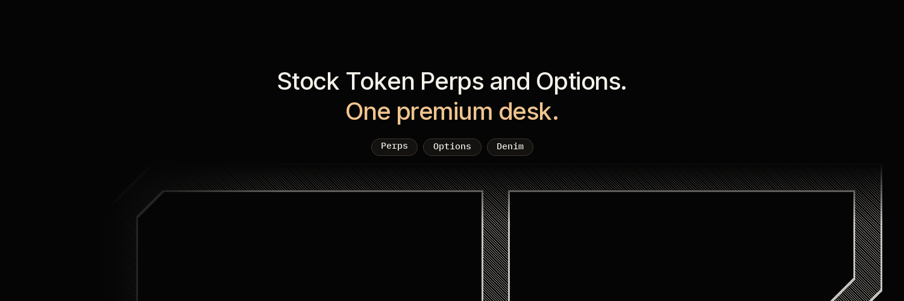

<p align="center"></p>

<h1 align="center">Meridian Desk</h1>

<p align="center"><b>Perps and options on Stock Tokens. One desk, one ledger, on Robinhood Chain.</b></p>

<p align="center">
  <a href="https://meridiandesk.tech">meridiandesk.tech</a> ·
  <a href="https://x.com/MeridianDesk33">@MeridianDesk33</a> ·
  $MRDN <a href="https://robinhoodchain.blockscout.com/token/0x6437614ea1efba0eb4b43bc1af53808722b1cf13"><code>0x6437…cf13</code></a>
</p>

<p align="center">
  
  
  
  
  
  
</p>

---

Meridian Desk lists the Stock Token catalog of Robinhood Chain and opens two desks on top of it. The **Perps desk** trades long and short with leverage capped at 2×. The **Options desk** sells calls and puts, cash-settled at expiry. Both desks price off Chainlink and share a single USDG liquidity pool.

You can keep each position on its own margin (**Isolated**), or put both desks on one wallet (**Cross**, a.k.a. the *Common Ledger*). On Cross, profit in one leg supports the other.

> [!WARNING]
> **Unaudited beta.** The contracts have not had an external audit. Mainnet runs with guarded deposit and open-interest caps behind a Safe multisig. Only use funds you can afford to lose.

## Highlights

| | |
|---|---|
| **Perps** | Isolated long/short with fixed leverage steps 1× · 1.25× · 1.5× · 2×. Per-market funding. Keeper liquidations. |
| **Options** | Buy-to-open calls and puts. Priced with EIP-712 signed RFQ quotes, cash-settled in USDG from the Chainlink round at expiry. |
| **Common Ledger** | Cross margin across both desks. Long options count toward equity after a 20% haircut. One account, one liquidation line. |
| **Liquidity** | ERC-4626 USDG vault, counterparty for every desk. Reservations and caps keep open interest within what LPs can pay. |
| **Backstop** | An Insurance Fund absorbs liquidation deficits. Anything beyond it is recorded on-chain as bad debt, never hidden. |
| **Governance** | Every admin role sits with a Safe multisig. Parameter changes ship as reviewed batch files in `contracts/script/mainnet/batches/`. |

## How the Common Ledger works

```
Equity       = wallet + Σ perps uPnL + 80% × Σ fresh long-option mark
Maintenance  = Σ notional × 25%
Margin ratio = Maintenance / Equity
```

| State | What happens |
|---|---|
| Margin ratio < 100% | Healthy. New exposure is allowed within initial margin. |
| Margin ratio ≥ 100% | Liquidatable by anyone. The 0.50% fee splits 0.30% to the Insurance Fund and 0.20% to the caller. |
| Equity < ⅔ × maintenance | Backstop. Remaining positions close, and the Insurance Fund covers the deficit. |
| Oracle stale | New exposure and withdrawals pause, and liquidation waits for a fresh price (stock feeds stop on weekends). |

Full rationale: [`ADR-002`](docs/adr/ADR-002-cross-margin.md). Isolated risk model: [`ADR-001`](docs/adr/ADR-001-risk-model.md).

## Architecture

```
                        ┌──────────────────┐
                        │  MarketRegistry  │  catalog + desk flags
                        └────────┬─────────┘
                                 │
  Chainlink ──► OracleRouter ────┼──────────────┬────────────────────┐
                (stale guard)    │              │                    │
                          ┌──────▼──────┐ ┌─────▼─────────┐ ┌────────▼───────────┐
                          │ PerpsEngine │ │ OptionsEngine │ │ CrossMarginAccount │──► CrossOptionBook
                          │ (isolated)  │ │ (RFQ, EIP712) │ │  (Common Ledger)   │
                          └──────┬──────┘ └─────┬─────────┘ └────────┬───────────┘
                                 │              │                    │ deficits
                                 └─────► LiquidityPool ◄─────────────┤
                                         (ERC-4626 USDG)       InsuranceFund
```

## Contracts

| Contract | Role |
|---|---|
| `MarketRegistry` | Stock Token catalog, Chainlink feed per token, per-desk enable flags |
| `OracleRouter` | Normalises Chainlink prices, rejects stale rounds, proves the expiry round for options |
| `LiquidityPool` | ERC-4626 USDG vault, reservations, deposit caps, pause |
| `PerpsEngine` | Isolated perps, leverage hard-capped at 2×, funding, liquidation |
| `OptionsEngine` | Buy-to-open options, EIP-712 RFQ quotes, cash settlement |
| `CrossMarginAccount` | Common Ledger wallet, cross perps, account-level liquidation |
| `CrossOptionBook` | Long options held inside a Cross account (split out to stay under EIP-170) |
| `InsuranceFund` | Liquidation backstop for Cross accounts |

### Robinhood Chain mainnet (4663)

| Contract | Address |
|---|---|
| MarketRegistry | [`0x98d814FF6f36E961CBF1b40af1bec146164AE347`](https://robinhoodchain.blockscout.com/address/0x98d814FF6f36E961CBF1b40af1bec146164AE347) |
| OracleRouter | [`0xB739878Be957dEeaeB836D4A05A63b22A08D98Be`](https://robinhoodchain.blockscout.com/address/0xB739878Be957dEeaeB836D4A05A63b22A08D98Be) |
| LiquidityPool | [`0xa7BC06622a45612d41066039d050618A2b4D8E9f`](https://robinhoodchain.blockscout.com/address/0xa7BC06622a45612d41066039d050618A2b4D8E9f) |
| PerpsEngine | [`0xf6b07174CD2244D928e9e012D4703B3984712B6A`](https://robinhoodchain.blockscout.com/address/0xf6b07174CD2244D928e9e012D4703B3984712B6A) |
| OptionsEngine | [`0xDC44F3e91B782584eEd60D1e3E57F3638217aA21`](https://robinhoodchain.blockscout.com/address/0xDC44F3e91B782584eEd60D1e3E57F3638217aA21) |
| CrossMarginAccount | [`0x9985AfB0A32AE4bAc99f343c5D9AD75159e76A76`](https://robinhoodchain.blockscout.com/address/0x9985AfB0A32AE4bAc99f343c5D9AD75159e76A76) |
| CrossOptionBook | [`0x51b9192e15BA39b1Ad390F4F5288FD8c8EB84AfA`](https://robinhoodchain.blockscout.com/address/0x51b9192e15BA39b1Ad390F4F5288FD8c8EB84AfA) |
| InsuranceFund | [`0x762cAB17435f54f9c5848B04a45F8aBe639BF8e8`](https://robinhoodchain.blockscout.com/address/0x762cAB17435f54f9c5848B04a45F8aBe639BF8e8) |
| Admin (Safe) | [`0xeEa7FA2dD4CA77DD230ca4A41eB46ec8A3D89D38`](https://robinhoodchain.blockscout.com/address/0xeEa7FA2dD4CA77DD230ca4A41eB46ec8A3D89D38) |
| USDG (collateral) | [`0x5fc5360D0400a0Fd4f2af552ADD042D716F1d168`](https://robinhoodchain.blockscout.com/address/0x5fc5360D0400a0Fd4f2af552ADD042D716F1d168) |

Testnet (46630) addresses and listed markets live in [`contracts/deployments/`](contracts/deployments). The web app syncs them with `apps/web/scripts/sync-deployments.mjs`, so addresses are never typed by hand.

### Guarded launch

| Parameter | Value |
|---|---|
| Leverage | 1× · 1.25× · 1.5× · 2× (hard cap) |
| Cross deposits | 100 USDG per account · 1,000 USDG total |
| Cross markets | TSLA, 500 USDG open interest |
| Long-option haircut | 20% |
| Liquidation fee | 0.50% (0.30% Insurance Fund · 0.20% keeper) |

Caps are raised only through a Safe batch.

## Quickstart

**Contracts**

```bash
git clone --recursive https://github.com/MeridianDesk/meridiandesk.git
cd meridiandesk/contracts
forge build
forge test                                            # unit, fuzz, invariant
RH_FORK_RPC=<mainnet rpc> forge test --mt Fork -vv    # read-only against live feeds
```

**Web app**

```bash
cd apps/web
npm install
npm run dev                              # testnet (default)
NEXT_PUBLIC_CHAIN_ID=4663 npm run dev    # mainnet
```

**Keeper**

```bash
cd keeper
npm install
# create keeper/.env with KEEPER_PK and RH_RPC_MAINNET (never commit it)
node keeper.mjs --once --chain=4663      # dry run
node keeper.mjs --live --chain=4663
```

The keeper runs isolated liquidations, Cross account liquidations and option settlement. Liquidation is permissionless, so anyone can run one.

## Repository

```
contracts/
  src/            core contracts, src/cross = Common Ledger
  test/           unit, fuzz, invariant and mainnet-fork tests
  script/         deploy scripts; script/mainnet = Safe batches + keystore-only ops
  deployments/    addresses per chain (source of truth)
apps/web/         Next.js desk: landing, docs, perps, options, cross
keeper/           liquidation + settlement bot
docs/adr/         risk-model decisions
```

No script holds a private key. Broadcasts use `cast --account` keystores, and admin actions go through the Safe.

## Security

Please report vulnerabilities privately. See [SECURITY.md](SECURITY.md).

## License

[MIT](LICENSE)

<sub>Meridian Desk is not affiliated with Robinhood Markets or its affiliates. Stock Tokens are issued by Robinhood Assets (Jersey) Limited. Not investment advice.</sub>
